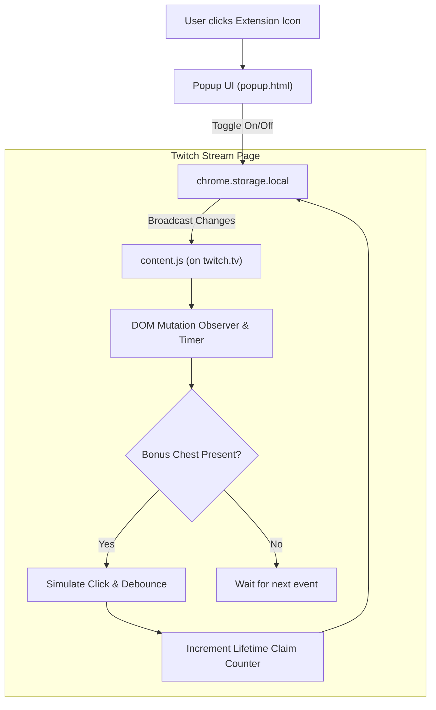

# Twitch Channel Points Auto-Claimer

A lightweight, privacy-friendly Google Chrome extension (Manifest V3) that automatically claims Twitch bonus channel points in real-time.

[](#)
[](#)
[](#)
[](LICENSE)

---

## 💡 Overview

Twitch streams periodically award bonus channel points via a clickable chest at the bottom of the chat. Third-party multi-tools or extensions can often miss these claims due to Single Page Application (SPA) re-renders, heavy overhead, or unexpected desyncs.

This extension was engineered to solve that specific problem with maximum reliability and minimal footprint:
- **Strictly scoped**: Runs only when browsing `twitch.tv` and remains 100% dormant on all other websites.
- **Instant toggle switch**: Enable or pause claiming at any time directly from the Chrome toolbar without refreshing the stream.
- **Zero bloat**: Built entirely with vanilla JavaScript, zero dependencies, zero tracking, and zero background worker polling.

---

## ✨ Features

- **Automated Claiming**: Detects bonus opportunities instantly using a hybrid `MutationObserver` and resilient fallback scan.
- **Reactive Popup UI**: Sleek Twitch-themed dark mode popup with live active/paused indicator.
- **Lifetime Statistics**: Keeps a persistent counter of total bonuses claimed using `chrome.storage.local`.
- **Localization Resilient**: Intelligently identifies claim chests across multiple languages and dynamic DOM structures.
- **Debounced Clicks**: Prevents accidental double-clicks or spamming Twitch's API before the button unmounts.

---

## 🛠️ Project Structure

```text
Twitch_extension/
├── manifest.json          # Chrome Manifest V3 configuration & permission scoping
├── popup/
│   ├── popup.html         # User interface with toggle switch & claim counter
│   ├── popup.css          # Twitch-themed dark mode styles
│   └── popup.js           # Reactive state management & storage synchronization
├── scripts/
│   └── content.js         # Claim detection engine injected into twitch.tv
├── icons/
│   ├── icon16.png         # Browser toolbar icon
│   ├── icon48.png         # Extension management icon
│   └── icon128.png        # Web store & detail view icon
├── .gitignore             # Git ignore rules
├── LICENSE                # MIT License
└── README.md              # Project documentation & installation guide
```

---

## 🚀 Installation (Load Unpacked in Chrome)

You can load and use this extension in Google Chrome, Brave, Microsoft Edge, or any Chromium-based browser in less than a minute:

1. **Clone or Download this repository**:
   ```bash
   git clone https://github.com/your-username/twitch-channel-points-auto-claimer.git
   ```
2. **Open Extensions in Chrome**:
   - Navigate to `chrome://extensions` in your browser address bar.
3. **Enable Developer Mode**:
   - Toggle the **Developer mode** switch in the top-right corner.
4. **Load the Extension**:
   - Click the **Load unpacked** button in the top-left.
   - Select the `Twitch_extension` folder containing `manifest.json`.
5. **Pin to Toolbar**:
   - Click the puzzle piece icon (Extensions) in your Chrome toolbar and pin **Auto-Claimer** for quick access.

---

## 🔍 How It Works



1. **Permission Scoping**: The `manifest.json` specifies `"matches": ["https://*.twitch.tv/*"]`. When you visit any other domain (e.g. YouTube, GitHub, Google), Chrome does not execute any code.
2. **State Syncing**: The popup writes the active state to `chrome.storage.local`. The content script listens via `chrome.storage.onChanged`, immediately enabling or disabling auto-claiming without requiring a tab reload.
3. **Detection Algorithm**: Watches the DOM for Twitch's community points container (`.community-points-summary`, `[aria-label="Claim Bonus"]`, or `.claimable-bonus__icon`), automatically clicking and debouncing to prevent spam.

---

## 🔒 Privacy & Permissions

This extension is built with absolute transparency and respect for user privacy:
- **No Remote Scripts**: All code is 100% local.
- **No Analytics / Telemetry**: No tracking pixels, no telemetry endpoints, no third-party APIs.
- **Minimal Permissions**: Requests only `"storage"` permission to save your toggle preference and claim count locally on your machine.

---

## 📄 License

Distributed under the MIT License. See [`LICENSE`](LICENSE) for more information.
